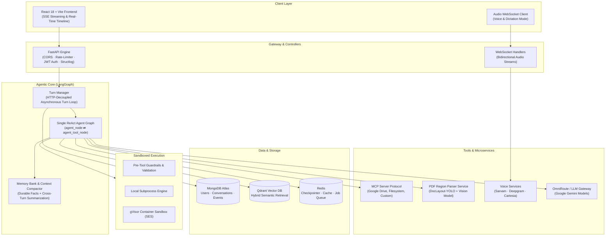

# Sandboxed Agent Engine

[](https://python.org)
[](https://fastapi.tiangolo.com)
[](https://langchain-ai.github.io/langgraph/)
[](https://react.dev)
[](https://vitejs.dev)
[](https://tailwindcss.com)
[](https://docker.com)
[](LICENSE)

An enterprise-grade autonomous AI agent engine featuring secure sandboxed code execution, dynamic skill acquisition, Model Context Protocol (MCP) integrations, multi-modal document understanding, and a decoupled turn lifecycle.

---

## Architecture Overview



---

## Core Features

- **Isolated Sandboxed Execution:** Supports local isolated execution and remote gVisor container runtimes (`SANDBOX_EXECUTOR_MODE=remote`) to execute untrusted Python and shell commands safely.
- **Decoupled Turn Lifecycle:** LLM reasoning and execution loops run asynchronously in background tasks managed by `TurnManager`. Closing the browser does not terminate agent turns; returning re-attaches to the live stream.
- **Dynamic Skills Vault:** Built-in and dynamically loadable skills with YAML frontmatter triggers (e.g. `create-pdf`, `spreadsheet-analyst`, `web-artifacts-builder`, `algorithmic-art`).
- **Model Context Protocol (MCP):** Connect external data stores and enterprise tools (Google Drive, filesystem, API servers) via SSE/stdio transport with automated OAuth 2.1 PKCE discovery.
- **Context Compaction & Memory:** Automatic background durable fact extraction and cross-turn summary compaction to maintain long-horizon coherence without context window overflow.
- **Agentic RAG & Document Parsing:** Hybrid semantic search with Qdrant alongside a dedicated microservice using DocLayout-YOLO for vision-based layout-preserving OCR.
- **Full-Duplex Voice Interaction:** Streaming voice pipeline supporting Indian and English language models with sub-second turnaround.

---

## Repository Structure

```
Sandboxed-agent-engine/
├── backend/
│   ├── config/              # LLM models and RAG configuration
│   ├── controllers/         # API controllers
│   ├── core/                # DB, auth, cache, limiter, logging middleware
│   ├── deploy/              # Nginx reverse proxy and deployment configs
│   ├── graph/               # LangGraph ReAct engine, nodes, and state definitions
│   ├── models/              # Pydantic schemas and database models
│   ├── pdf-parser/          # Standalone DocLayout-YOLO PDF parser microservice
│   ├── rag/                 # Vector ingestion, chunking, and hybrid retrieval
│   ├── routes/              # FastAPI route endpoints
│   ├── services/            # Chat, history, memory, turn management services
│   ├── skills/              # Built-in skills library and loader
│   ├── tests/               # Test suites (unit, regression, and e2e)
│   ├── tools/               # REPL, shell, search, and document creation tools
│   ├── utils/               # Code executor, sandbox client, guardrail hooks
│   ├── voice/               # Real-time STT/TTS audio streaming pipeline
│   ├── Dockerfile           # Backend container definition
│   └── requirements.txt     # Python dependencies
├── frontend/
│   ├── public/              # Static assets and icons
│   ├── src/
│   │   ├── components/      # React components (chat, auth, mcp, layout, arch)
│   │   ├── context/         # Auth, chat, and theme providers
│   │   ├── pages/           # Application views and dashboards
│   │   ├── services/        # API client and WebSocket streaming wrappers
│   │   └── App.jsx          # Root application and route definitions
│   ├── package.json         # Frontend dependencies and scripts
│   └── vite.config.js       # Vite build configuration
└── README.md
```

---

## Getting Started

### Prerequisites
- Python 3.11+
- Node.js 18+ & npm
- MongoDB Atlas or local MongoDB instance
- Redis instance
- Qdrant Vector Database

### Backend Setup

1. Navigate to the backend directory:
   ```bash
   cd backend
   ```
2. Create and activate a virtual environment:
   ```bash
   python -m venv venv
   source venv/bin/activate  # On Windows: .\venv\Scripts\activate
   ```
3. Install dependencies:
   ```bash
   pip install -r requirements.txt
   ```
4. Copy environment configuration and update keys:
   ```bash
   cp .env.sample .env
   ```
5. Run the server:
   ```bash
   uvicorn main:app --reload --port 8000
   ```

### Frontend Setup

1. Navigate to the frontend directory:
   ```bash
   cd frontend
   ```
2. Install dependencies:
   ```bash
   npm install
   ```
3. Start the development server:
   ```bash
   npm run dev
   ```
4. Open [http://localhost:5173](http://localhost:5173) in your browser.

---

## Testing

Run the automated test suite in the backend:
```bash
cd backend
python -m pytest -q --ignore=tests/test_integration_live.py
```

---

## License

This project is licensed under the MIT License.
